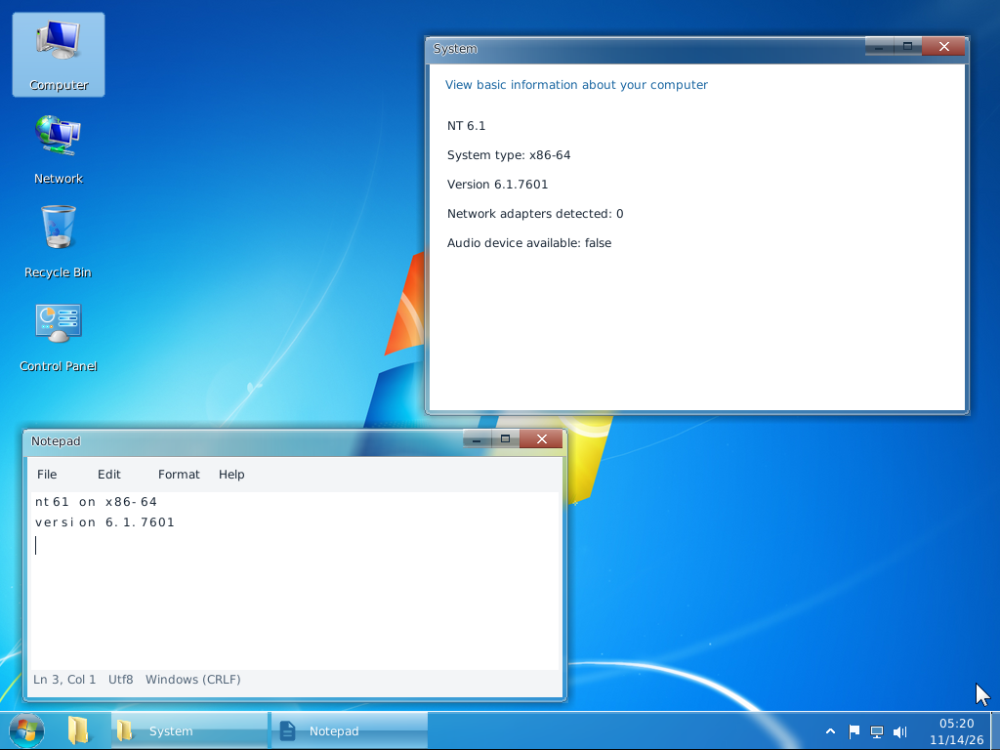
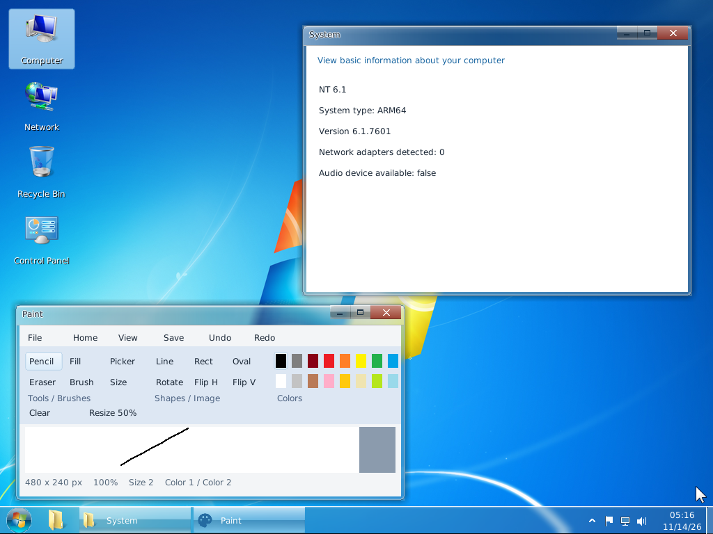
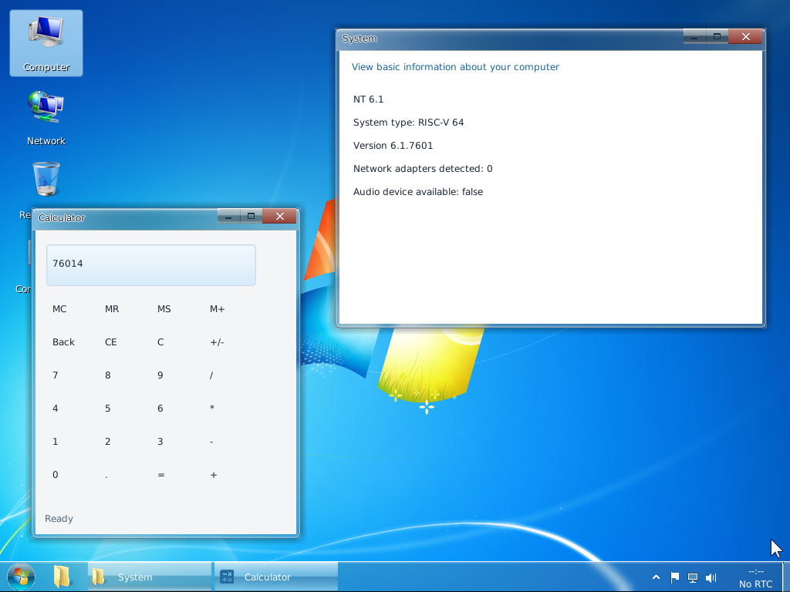

# NT6.1 — A Windows 7–Inspired Operating System in Rust

NT6.1 is an experimental operating system targeting the architecture and interfaces of Windows 7 SP1 (NT 6.1.7601). It contains a UEFI boot manager, an NT-style kernel, filesystem and device drivers, a registry, a desktop shell, and built-in applications implemented in Rust.

The project boots to an interactive desktop on **x86-64, ARM64, RISC-V 64, and LoongArch64** in QEMU. Windows application compatibility remains incomplete: a working desktop does not establish compatibility with arbitrary Windows executables or drivers. This is an independent research project, not a Microsoft Windows distribution.

## Desktop screenshots

These four 1024 × 768 screenshots were captured directly from separate QEMU guests on November 14, 2026, using the existing NTFS images, four virtual CPUs, and VirtIO GPU. In every guest, **right-click Computer → Properties** opens the System page, whose **System type** identifies the architecture. Each screenshot also shows a different built-in application. The guests used isolated disk/firmware snapshots and no network adapter, so the System page reports zero network adapters.


<table>
  <tr>
    <td align="center">
      <br>
      <b>x86-64 desktop with Computer Properties and Notepad</b>
    </td>
    <td align="center">
      <br>
      <b>ARM64 desktop with Computer Properties and Paint</b>
    </td>
  </tr>
  <tr>
    <td align="center">
      <br>
      <b>RISC-V 64 desktop with Computer Properties and Calculator</b>
    </td>
    <td align="center">
      <br>
      <b>LoongArch64 desktop with Computer Properties and Windows Task Manager</b>
    </td>
  </tr>
</table>

## Current implementation

- **Boot:** UEFI boot manager, a five-second default selection timeout, boot-policy handoff, advanced boot options, memory diagnostics, and startup animation. Availability of individual recovery actions depends on the underlying implementation.
- **Kernel:** process and thread management, scheduling, virtual memory, object handles, interrupt and exception handling, security tokens, and NT-style system-call dispatch. Architecture-specific paging and trap code lives under `crates/arch/`.
- **Storage and filesystems:** mounted-volume services connect the desktop and command environment to filesystem drivers. Explorer supports directory enumeration and implemented create, rename, delete, and file operations. NTFS, FAT32, and ext-family support have different feature limits; filesystem support is not equivalent to full Windows filesystem semantics.
- **Registry:** generated REGF SYSTEM, SOFTWARE, SAM, SECURITY, and DEFAULT hives; ASCII case-insensitive key/value lookup and machine-root aliases. Full Unicode registry comparison and complete Windows Configuration Manager behavior remain work in progress.
- **Desktop:** Aero-style composition, taskbar and Start menu, notification flyouts, window controls, eight-direction resizing, pointer handling, and a shared filesystem-backed Explorer. Shell icon resources are packaged into the system image.
- **Logon:** an enabled Administrator account with an empty password for the default interactive session, kernel authentication, and LogonUI-to-Explorer handoff.
- **Applications:** shared application code under `crates/desktop/src/applications/`, including Explorer, Notepad, Paint, Calculator, Task Manager, Command Prompt, and additional accessories. Editors and Paint have shared open/save dialogs. Some catalog entries are partial or explicitly deferred.
- **Command environment:** implemented filesystem, text, registry, and system commands, plus supported DiskPart and BCDEdit operations. This is a subset of Windows 7 commands; unsupported operations should return an error.
- **Display and devices:** framebuffer/boot-video presentation, VirtIO GPU basic display, VirtIO block/input devices, and experimental network, audio, USB, and other driver components. Aero rendering does not imply a complete WDDM or Direct3D driver.
- **Win32 and WOW64:** Rust libraries model NT/Win32 interfaces. The portable x86/x64 interpreter has checked guest memory, bounded execution, PE loading, ordinary DLL import linking, and executable TLS initialization for the initial thread. Native translation backends, DLL initialization/TLS lifecycle, broad Win32 coverage, and full WOW64 compatibility remain incomplete. Firefox installation and browsing are not verified.

## Build and run

Run commands from the repository root. The build tools create architecture-specific outputs under `build/<ARCH>/<FORMAT>/`.

### Host prerequisites

A Linux development host needs:

- Rust and Cargo with the required bare-metal and UEFI targets; use a toolchain that supports the targets below and the crate feature requirements.
- GNU Make, Python 3 for validation scripts, and QEMU system emulators for the architectures being tested.
- OVMF for x86-64 and EDK2 firmware under `scripts/firmware/` for the other architectures. RISC-V also uses OpenSBI.
- Cross-binutils used by the firmware/PE build paths, particularly `riscv64-linux-gnu-*` and `loongarch64-linux-gnu-*`. The cross-linker configuration under `crates/boot/.cargo/` and `crates/winload/.cargo/` must match the host installation.
- `virt-fw-vars` from `virt-firmware` for preparing firmware boot entries. GTK is needed for the default graphical QEMU display.
- Host image utilities required by the selected build/validation path, such as `mtools`, `dosfstools`, `e2fsprogs`, `ntfs-3g`, and `qemu-img`.

Install the Rust targets used by the four build paths:

```sh
rustup target add \
  x86_64-unknown-none x86_64-unknown-uefi \
  aarch64-unknown-none aarch64-unknown-uefi \
  riscv64gc-unknown-none-elf loongarch64-unknown-none
```

Prepare firmware:

```sh
make download-firmware
make check-firmware
```

The default `make run` path configures the host QEMU bridge if needed and may invoke `sudo` for that setup. The snapshot-based desktop validation command below disables guest networking and does not require bridge setup.

### Start a desktop

```sh
# Default: x86-64, NTFS, VirtIO GPU, 8 GiB RAM, four virtual CPUs.
make run

# Other architectures use the same entry point.
make run ARCH=aarch64
make run ARCH=riscv64
make run ARCH=loongarch64
```

The default interactive user is **Administrator**, with **no password**. Submit the empty password field on the login screen to enter the desktop. Right-click **Computer** and choose **Properties** to inspect the guest architecture.

The normal display mode is `QEMU_GPU_MODE=safe` (VirtIO basic display). Use `QEMU_GPU_MODE=ramfb` for the firmware framebuffer path. The optional `gl` mode requires a suitable host graphics setup and does not establish Direct3D compatibility.

### Build without starting QEMU

```sh
make build ARCH=x86_64 FORMAT=ntfs
make build ARCH=aarch64 FORMAT=ntfs
make build ARCH=riscv64 FORMAT=ntfs
make build ARCH=loongarch64 FORMAT=ntfs

# Example: increase the system partition size in MiB.
make build ARCH=x86_64 FORMAT=ntfs SYSTEM_SIZE_MB=1024
```

### Image formats

`FORMAT` accepts `ntfs`, `fat32`, `ext4`, `refs`, `qcow2`, `ramfs` (also `img`), and `iso`. For example:

```sh
make run ARCH=x86_64 FORMAT=fat32
make build ARCH=aarch64 FORMAT=ext4
make build ARCH=riscv64 FORMAT=qcow2
make build ARCH=loongarch64 FORMAT=iso
```

QCOW2 is a container format. RAMFS/IMG and ISO use RAM-backed boot paths. The current `refs` implementation is a **project-specific experimental format**, not interoperable Microsoft ReFS. The screenshots above validate NTFS desktop boots only; they do not certify every architecture/format combination.

Build outputs include the image under `build/<ARCH>/<FORMAT>/images/`, the staged system files under `build/<ARCH>/<FORMAT>/system/`, and the EFI system partition tree under `build/<ARCH>/<FORMAT>/esp/`. Normal run logs are written to `build/<ARCH>/<FORMAT>/images/serial_<ARCH>_<FORMAT>.log`.

## Validation

After building the relevant images and preparing their firmware, run the desktop smoke test against isolated QEMU snapshots:

```sh
python3 scripts/test-desktop-boot.py \
  x86_64 aarch64 riscv64 loongarch64 \
  --gpu virtio --cpus 4 --jobs 1 --timeout 600
```

The test records serial output and real framebuffer captures under `build/desktop-validation/`. It checks boot animation, login, desktop presentation, and Start menu input. Use `--shell-ui`, `--window-resize`, `--explorer-vfs`, `--document-applications`, or `--display-integrity` for additional focused checks; see `--help` for available options. Resource requirements increase with `--jobs`.

A focused registry packaging regression uses the kernel hive parser to validate generated system hives:

```sh
cargo test -p nt61-tools --test system_registry
```

## Repository layout

```text
.
├── Cargo.toml                  Rust workspace
├── Makefile                    Build and QEMU entry points
├── assets/                     README screenshots
├── crates/
│   ├── init/                   Kernel entry binaries and integration crate
│   ├── arch/                   Architecture code and portable guest interpreter
│   ├── abi/                    Shared ABI and desktop service definitions
│   ├── boot-types/             Boot handoff structures and policies
│   ├── boot/                   UEFI boot manager
│   ├── bootfs/                 Shared boot filesystem readers
│   ├── winload/                NT-style OS loader
│   ├── boot-driver/            Boot-time driver payload
│   ├── ntoskrnl/               Executive, memory, processes, objects, security
│   ├── hal/                    Hardware abstraction
│   ├── drivers/                Storage, input, video, network, other devices
│   ├── fs/                     Mounted volumes and filesystem implementations
│   ├── registry/               Configuration Manager and hive parsing
│   ├── netstack/               Network protocols
│   ├── crypto/                 Cryptographic primitives
│   ├── loader/                 Image loading
│   ├── desktop/                Shell, composition, controls, and UI resources
│   │   └── src/applications/   Shared built-in application implementations
│   ├── libs/                   NT/Win32 compatibility libraries
│   ├── subsystems/             Win32k and WOW64 components
│   ├── system/                 Session/services processes and command backend
│   ├── userland/               User runtime and command entry points
│   └── tools/                  Image builder, PE/resource packaging, tests
├── resources/                  Fonts and other shared inputs
├── scripts/                    Firmware preparation and validation tools
└── docs/                       Technical documentation
```

## Compatibility goals and limitations

The reference version is Windows 7 SP1 / NT 6.1.7601. Matching executable names, registry values, window layouts, and API signatures is only part of that goal. Many APIs and drivers remain partial, and some packaged DLL exports are placeholders. Cross-architecture native application execution, x86/x64 translation, SMP stability, network protocols, graphics acceleration, and persistent filesystem semantics need continued validation with real workloads.

Applications whose dependencies are unavailable are listed in `crates/desktop/src/applications/catalog.rs` as deferred.

## Contributing and licensing

Keep changes focused, run the checks relevant to the subsystem, and test affected architecture builds. Include reproduction steps and serial logs for boot or driver failures; keep generated images, logs, and temporary tools outside source commits.

See [LICENSE](LICENSE) for the repository license. Application artwork attribution and source information are retained under `crates/desktop/assets/applications/`. Other bundled resources and firmware may have their own licensing terms; review them before redistribution.
